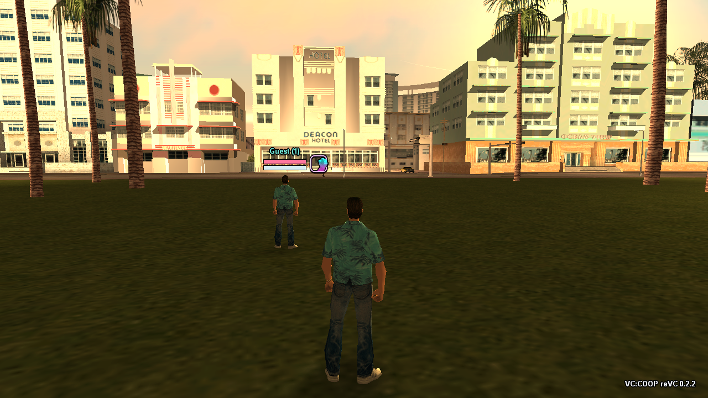

# reVC-Coop


[](MIGRATION.md)

[](#base-and-third-party-code)

<p align="center"><a href="README.md">Русский</a> · <b>English</b></p>

Cooperative multiplayer for **GTA Vice City**, built directly into the reVC engine. A friend joins the shared world as their own Tommy.

## Players

Running, jumping, weapon changes, shooting and shot effects. Your teammate has a name tag, health and armour bars, a weapon icon and their wanted stars. Each player keeps their own wanted level; NPCs react to aiming, gunfire and hits from both players. One player's death or arrest does not reset their teammate's world.



## Vehicles and world

Drive or ride as a passenger. Vehicle movement, wheel rotation and damage are replicated; the shared session includes traffic and pedestrians. Police helicopters are created by the shared session. Street weapons, ammunition, money, health and armour are collected once and disappear for everyone.

**Host — driving**


**Guest — passenger**


## Chat and interface

Cyrillic input, speech bubbles and teammate radar blips. Chat styling is fixed; `/fontsize` and `/pagesize` adjust text size and the number of visible lines.

## Run

1. [Build the project](docs/BUILDING.md). You need your own classic GTA Vice City game files; Definitive Edition is not supported.
2. Copy `reVC.exe` and the contents of `gamefiles/` into a separate test installation. Launch `reVC.exe`.
3. Create `vc-coop.ini` next to it:

```ini
[native]
sandbox=1
name=Host
host=1
auto_connect=1
address=127.0.0.1
port=7781
fps_limit=60
```

For the guest, set `name=Guest`, `host=0`, and `address=` to the host's IP. Keep `127.0.0.1` for two instances on one PC. Network play requires access to UDP port `7781`.

`sandbox=1` enables the free-roam test world with story scripts disabled. **F8** opens the connection menu.

## Controls

| Key | Action |
| :--- | :--- |
| **F8** | Connection menu |
| **T** / **Enter** | Open chat |
| **Enter** / **Esc** | Send / close chat |
| **G** | Take a nearby free passenger seat |
| **Tab** | Player list |
| **F7** | Show / hide chat |
| **PgUp** / **PgDn** | Chat history |

## Current status

This is an early free-roam build. Synchronisation is still being refined, especially vehicle contacts and behaviour under network latency. Story missions, cutscenes and shared progress saving have not been ported yet.

Online play defaults to **60 FPS**. Set `fps_limit` in `vc-coop.ini` to any positive integer, or `0` for no limit, then restart the game. Cooperative simulation uses the original 30 Hz cadence independently of rendering. Raise FPS at your own risk: not every effect and gameplay scenario has been verified at high render rates.

Standard ASI/CLEO plugins do not work with this build: the cooperative module is compiled into `reVC.exe`.

[Building](docs/BUILDING.md) · [Technical changes and verification](MIGRATION.md)

## Base and third-party code

[reVC](https://github.com/mrxenginner/reVC/tree/miami) · [librw](https://github.com/mrxenginner/librw) · [ENet](https://github.com/lsalzman/enet) · [SA:COOP](https://github.com/Karimov-Akbar/sa-coop)

reVC-Coop changes are under [MIT](LICENSE). Original reVC notices are retained in [LICENSE.md](LICENSE.md); its previous README is [archived here](docs/UPSTREAM_README.md). Reused-code licences are in [coop/vendor](coop/vendor). The original game's data files are not included.
